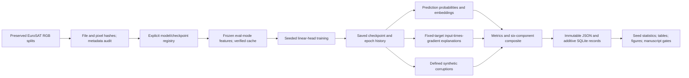

# Implemented methodology (revision-v1)

The supported workflow is `src/cropxai`; the older `src/research` tree contains prototypes and is not the validated execution path. No public release is asserted. The experiment is **EuroSAT land-cover classification** in two input representations (RGB JPEG for three ImageNet models; six Sentinel-2 bands for Prithvi-EO-1.0-100M), not crop-health diagnosis; no 13-band experiment is run.

## Data and inputs
The preserved split contains 18,900 training, 4,050 validation and 4,050 test JPEGs, ten classes, RGB 64x64. Class counts differ (2,000, 2,500 or 3,000 original images per class). SHA256 file and decoded-pixel comparisons found no identical cross-split samples. This excludes exact duplicates only: nearby geography, near-duplicates, label quality and geographic leakage cannot be ruled out without geospatial metadata. See the sample-level manifest and split digest. The upstream release version is NOT AVAILABLE; local content is identified by hashes.

RGB channels correspond to Sentinel-2 B04/B03/B02 according to the official RGB release; JPEGs do not retain original spectral/geographic metadata. Files are bilinearly resized to 224x224 with antialiasing, converted to [0,1], and normalized with mean (.485,.456,.406), SD (.229,.224,.225). No normalization is fit to evaluation data. Train-only horizontal flip has probability .5. No validation/test augmentation. Unlike default torchvision inference recipes, common direct resize retains the full square patch instead of resizing then centre-cropping. This is a documented common-input experimental choice, not an exact reproduction of ImageNet evaluation. No images are discarded in the full campaign. The smoke protocol uses fixed class-balanced subsets and is not a benchmark.

## Six-band cohort
GeoTIFFs (13 bands, uint16, Level-1C) follow the same split by file stem. Stored band order (verified empirically, not documented in the files): B01..B08,B09,B10,B11,B12,B8A. Prithvi receives B02,B03,B04,B8A,B11,B12, standardized with its pretraining statistics and bilinearly upsampled 64->224. Noise severities for this cohort are on the reflectance unit scale (DN/10000), RGB on pixel/255; numerical severities are therefore not equivalent across cohorts.

## Training
ResNet-18, ViT-Base and ConvNeXt-T use local torchvision IMAGENET1K_V1 checkpoints, hash-checked against their identifiers. All backbone parameters and batch-normalization buffers are fixed; only the final linear head is optimized by Adam, learning rate .001, batch size 32, five epochs. Five independent initialization/shuffle seeds: 42,100,999,1234,2026. Final epoch is preselected; validation is diagnostic; no test selection. Both original and flipped training embeddings are cached. Head training draws a seeded sample permutation and Bernoulli flip for each image per epoch. This is equivalent to eval-mode frozen-backbone online feature extraction for those inputs, apart from floating-point roundoff; cache tests compare outputs. It is not equivalent to the legacy trainer, which updated batch-normalization state with `model.train()`.

## Explanations
Revision uses a single architecture-independent attribution rule: A(h,w)=sum_c |x(c,h,w) * d logit_target / dx(c,h,w)| on normalized inputs, then min-max normalizes each map to [0,1]. The target is the clean predicted class and remains fixed after perturbations. Constant maps are rejected. This differs from archived Grad-CAM results and is never merged with them. Use 10 fixed test samples per class (selection seed 445); smoke uses one. Stability is mean SSIM against maps from Gaussian noise sigma .05 on the unit scale of the representation, clipped before normalization. It is not a faithfulness proof.

Deletion ranks 16x16 patches by mean absolute attribution, descending, stable row-major tie order. At 20 approximately uniform deletion steps including intact/fully masked endpoints, replace selected pixels in all channels with normalized zero (ImageNet mean RGB). Evaluate the same clean predicted-class probability. Trapezoidal integration over the actual deleted fraction yields deletion AUC; lower is better. AOPC is mean original-minus-perturbed probability across nonzero steps; higher is better. Random and least-salient order controls use the same images/targets/schedule/baseline. This tests model response to deletion, but masking itself can create distribution shift; a low AUC alone is not evidence of ecological correctness.

## Six components
P=macro-F1; E=1-deletion AUC; C=1-ECE; R=mean accuracy over six synthetic corruption settings; U=1-Brier/2; Q=(silhouette+1)/2. Each is in [0,1]. E excludes stability; stability is separately reported. R is a proxy for synthetic covariate shift, **not measured geographical/seasonal OOD performance**. U uses a proper probability-error score; entropy is separately descriptive and is not interpreted as calibrated uncertainty quality. Q is Euclidean silhouette of L2-normalized penultimate features on the same fixed 20 samples per class. Class separation is a limited representation proxy, not downstream transfer or causal semantics. Different embedding dimensions may influence it. Macro-F1, calibration and Brier share information; component independence is not assumed.

T=sum_i w_i s_i, sum_i w_i=1, w_i>=0. Default/equal weights are 1/6 because no operational utility preference has been established. Reliability-priority and explanation-priority profiles are illustrative sensitivity scenarios, not empirically optimal policies. Fifty seeded multiplicative perturbations in [.8,1.2], renormalized, report scores, average-tie ranks, winners and Spearman correlation. A one-model or all-tied ranking has no defined correlation and is NOT COMPUTED. Missing/invalid components cause an error, never renormalization over available pillars. This is a **Composite Trust Score**, not a posterior probability or a calibrated guarantee of trustworthiness.

## Statistics
Two uncertainty sources are separated. Seed level: sample SD (ddof=1) and mean +/- t_(.975,n-1) SD/sqrt(n) over independently trained seeds under one protocol, split and source revision (n=5). Because the backbone is frozen, seeds randomize only head initialization, batch order and flips, so these intervals are narrow; the representation component is deterministic given the frozen backbone and has zero seed variance by construction. Test-item level: percentile bootstrap (10,000 draws, seed 445) over the 4,050 test patches of seed-averaged per-patch correctness; paired differences use identical patches and a Bonferroni-adjusted level. Seed-level paired differences of other metrics use Student-t intervals over shared seeds. Neither interval reflects geographic variation. All comparisons are exploratory. No Friedman/Nemenyi test and no critical-difference diagram is retained: seeds on one dataset are not multiple datasets.
